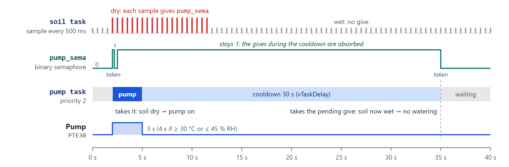
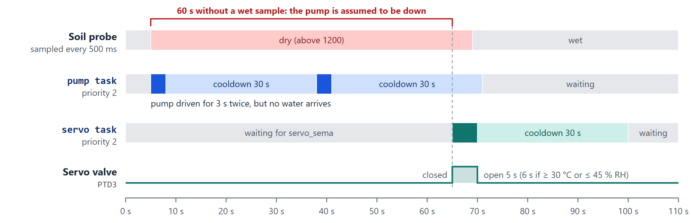
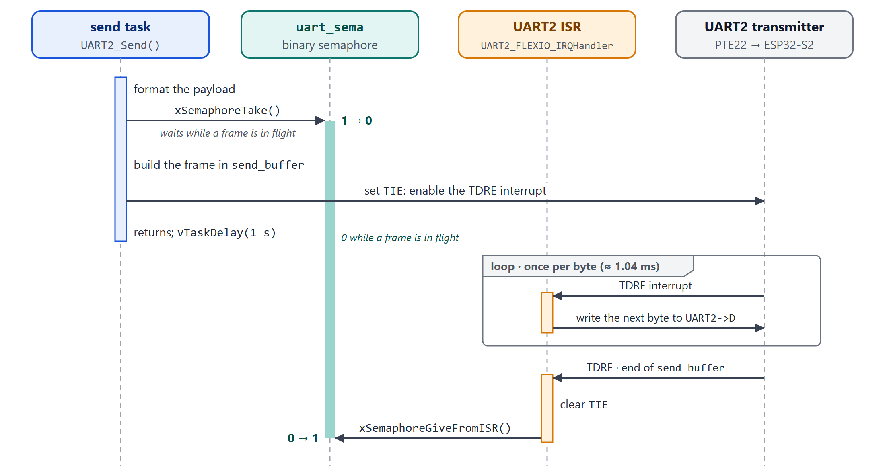
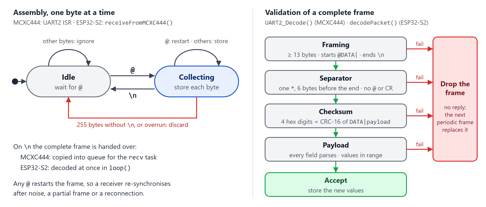

# CG2271 Real Time Operating Systems: Final Report

**2025/26 Semester 2 · Smart Greenhouse RTOS Project (JupiterPluvius auto-watering plant)**

**Group B0X_YY**

| Name | Matric number |
|---|---|
| Chen Xingtong | A0300595H |
| Nandhimandalam Madhavakrishna Nandhana | A0287034A |
| Wang Jiawei | A0308058A |
| Louis Agara Perin | A0306755Y |
| Hua Zhenting | A0283162H |

## Problem statement

**User story:** A busy student or professional needs a system that detects dry soil, waters a potted plant automatically and allows the user to monitor remotely.

The project automatically irrigates a potted plant according to soil moisture while preventing watering when reservoir water is insufficient and enforcing watering limits. It provides remote environmental monitoring and AI-assisted watering-profile recommendations.

## Sensors and actuators used

| Sensor / actuator | Description of use | Libraries used (if any) |
|---|---|---|
| DHT11 temperature and humidity sensor (ESP32-S2, GPIO7) | Measures air temperature and humidity every 3 s. The values are uploaded to the dashboard and sent to the MCXC444, which waters 1 s longer when it is hot (≥ 30 °C) or the air is dry (≤ 45 %). | DHTesp by beegee-tokyo: https://github.com/beegee-tokyo/DHTesp |
| Photoresistor (LDR) module (ESP32-S2, GPIO8) | Measures ambient light as a 12-bit analog value every 1 s (median of 9 samples). It decides bright or dark for the dashboard, and the MCXC444 uses it to switch the grow LED. | None (Arduino `analogRead()`) |
| Soil moisture probe (MCXC444, PTB2) | Analog probe read by ADC0 every 500 ms; a higher reading means drier soil. A reading above 1200 requests watering. | None (bare-metal ADC0 driver, `adc.c`) |
| Water-level probe (MCXC444, PTC6) | Analog output compared with a 1.65 V reference by the on-chip comparator CMP0, which interrupts when the reservoir level crosses the threshold. | None (bare-metal CMP0 driver, `cmp.c`) |
| Water pump (MCXC444, PTE30) | Main watering actuator: switched on for 3–4 s when the soil is dry, followed by a 30 s cooldown. | None (bare-metal GPIO, `gpio.c`) |
| Servo motor on a water valve (MCXC444, PTD3) | Fallback watering actuator: opens the valve for 5–6 s when the soil has stayed dry for 60 s, i.e. when the pump is down. | None (bare-metal TPM0 PWM driver, `pwm.c`) |
| Buzzer (MCXC444, PTA13) | Sounds while the reservoir is low. | None (bare-metal GPIO, `gpio.c`) |
| Grow LED (MCXC444, PTA5) | Switched on while it is dark, to give the plant light. | None (bare-metal GPIO, `gpio.c`) |

The MCXC444 firmware also uses the FreeRTOS kernel and the NXP MCUXpresso SDK (start-up code, clock set-up and debug console). The ESP32-S2 sketch also uses the Arduino-ESP32 core (Wi-Fi, HTTPS, UART) and Arduino_JSON to build the upload.

---

## 1 System overview

The plant is looked after by two microcontrollers and a cloud dashboard (Figure 1). The **MCXC444** runs FreeRTOS and handles everything that must react in real time: it samples the soil, watches the reservoir level and drives the pump, the buzzer and the grow LED. It also drives a servo valve, a fallback that waters the plant when the pump is down. The **ESP32-S2** measures air temperature, humidity and light, exchanges frames with the MCXC444 over UART, and uploads one reading to Supabase every 5 s. A FastAPI and React dashboard on Render shows the data and offers an AI check-up.


**Figure 1.** System architecture. The boards exchange UART frames in both directions; only the ESP32-S2 talks to the cloud.

**Table 1.** Hardware interfaces

| Signal | Pin | Peripheral and use |
|---|---|---|
| **MCXC444** | | |
| Soil moisture probe | PTB2 | ADC0 channel 12: 12-bit, calibrated at start-up, polled by `soil` |
| Reservoir level probe | PTC6 | CMP0 input 0 against its 6-bit DAC at 1.65 V, with hysteresis; interrupt on both edges |
| Pump driver | PTE30 | GPIO output, driven by `pump` |
| Servo valve (fallback) | PTD3 | TPM0 channel 3: 50 Hz PWM, 1 ms pulse = closed, 2 ms = open; driven by `servo` |
| Buzzer | PTA13 | GPIO output, driven by `water` |
| Grow LED | PTA5 | GPIO output, driven by `recv` |
| UART link | PTE22 (TX), PTE23 (RX) | UART2, 9600 baud 8N1, interrupt-driven |
| Debug console | PTA2 (TX), PTA1 (RX) | LPUART0, 115200 baud, used by `PRINTF` |
| **ESP32-S2** | | |
| DHT11 | GPIO7 | Temperature and humidity, read every 3 s |
| LDR | GPIO8 | 12-bit ADC (11 dB attenuation), median of 9 samples, read every 1 s |
| UART link | GPIO17 (TX), GPIO16 (RX) | UART1 (`Serial1`), 9600 baud 8N1 |

## 2 Software architecture

### 2.1 Task structure

The MCXC444 firmware runs FreeRTOS with preemptive scheduling and time slicing, a 200 Hz tick (5 ms) and five priority levels (0–4). `main()` initialises the clocks and pins, creates every queue, semaphore and mutex, initialises GPIO, ADC0, CMP0 and UART2, creates the six application tasks in Table 2 and starts the scheduler. All RTOS objects are allocated once, from the 10 KB `heap_4` heap, before the scheduler starts; nothing is created or deleted at run time.

**Table 2.** MCXC444 application tasks. Each has a 190-word (760-byte) stack.

| Task / function | Priority | Activation | Responsibility |
|---|---|---|---|
| **`recv`**<br>`recvTask` | 4 | Blocks on `queue` | Validates each received frame (framing and CRC), parses `TEMP`, `HUM` and `LIGHT_ADC`, switches the grow LED (on when `LIGHT_ADC` ≥ 1000, i.e. dark) and logs the values. |
| **`send`**<br>`sendTask` | 4 | Every 1 s (`vTaskDelay`) | Formats the status payload `SOIL`, `WATER`, `LED` and passes it to `UART2_Send()`. |
| **`soil`**<br>`soil_moisture_sensor_task` | 3 | Every 500 ms | Samples ADC0 into `moisture` and logs it. While the reading is above 1200 (dry) it gives `pump_sema`; once the soil has been dry for 60 s it also gives `servo_sema`. |
| **`water`**<br>`water_level_sensor_task` | 3 | Blocks on `reservoir_level_sema` | Sets the buzzer from `reservoir_level_ok` (on while the reservoir is low) at start-up and after every comparator edge; logs the level. |
| **`pump`**<br>`pumpTask` | 2 | Blocks on `pump_sema` | Re-checks `moisture`, runs the pump for 3 s (4 s at ≥ 30 °C or ≤ 45 % humidity), then waits 30 s before it can water again. |
| **`servo`**<br>`servoTask` | 2 | Blocks on `servo_sema` | Fallback for a pump that is down. Sets up the TPM0 PWM with the valve closed when it starts. Then re-checks `moisture`, opens the valve for 5 s (6 s at ≥ 30 °C or ≤ 45 % humidity), closes it and waits 30 s. |

FreeRTOS adds its idle task (priority 0) and timer service task (priority 4); the firmware uses no software timers.

**Priorities.** The two communication tasks run highest so the UART link is serviced promptly: `recv` processes a frame as soon as it is queued, and `send` keeps the 1 s status rate. The sensor tasks come next. The pump and servo tasks are lowest because their timing tolerance is in seconds and they spend almost all their time asleep. Every task blocks on a queue, a semaphore or `vTaskDelay()` between short bursts of work, so lower-priority tasks are not starved; the only busy-wait is the ADC conversion in `poll_soil_adc()`, which takes about 30 µs.

**Table 3.** Interrupt service routines (both at NVIC priority 2)

| ISR | Triggered by | Work done | Hands over to |
|---|---|---|---|
| `UART2_FLEXIO_IRQHandler` | Byte received (RDRF), receiver overrun (OR), or transmit register empty (TDRE, enabled only while a frame is being sent) | RX: adds the byte to the frame being assembled (Section 3.2). TX: writes the next byte of `send_buffer`; after the last one, disables the TDRE interrupt. | Frame received: `queue` → `recv`<br>Frame sent: `uart_sema` → `send` |
| `CMP0_IRQHandler` | Comparator output change: the reservoir level crosses the threshold | Clears the edge flags and stores the comparator output in `reservoir_level_ok`. | `reservoir_level_sema` → `water` |

Both handlers do a small, fixed amount of work, never block, call only the `…FromISR` FreeRTOS functions and end with `portYIELD_FROM_ISR()`, so a task they wake runs as soon as the interrupt returns. The servo's PWM is generated entirely by the TPM0 hardware and needs no interrupt.

#### ESP32-S2

The ESP32-S2 runs one Arduino `loop()` and creates no tasks of its own. Each job runs once its interval has elapsed on `millis()` (Table 4), and UART input is drained at the start of every pass, before any job that may wait on the network. Wi-Fi connection changes arrive as event callbacks that only log, and NTP synchronises the clock in the background.

**Table 4.** ESP32-S2 loop jobs

| Job | Interval | Function |
|---|---|---|
| Drain UART1 and decode status frames from the MCXC444 | Every pass | `receiveFromMCXC444()` |
| Read the LDR (median of 9 samples) | 1 s | `readLightSensor()` |
| Read the DHT11 | 3 s | `readDHT11()` |
| Send an environment frame to the MCXC444, only while both readings are fresh | 5 s | `sendToMCXC444()` |
| Upload one reading to Supabase over HTTPS | 5 s | `sendReadingsToSupabase()` |

### 2.2 Coordination & synchronisation

Interrupt handlers only capture an event and hand the rest to a task (deferred interrupt processing). Tasks never poll for events: each waits on exactly one RTOS object, or on `vTaskDelay()` if it is periodic. Figure 2 shows every object with its producer and consumer; Table 5 summarises them.


**Figure 2.** MCXC444 tasks, interrupts and synchronisation objects, one row per data path. Both UART2 ISR boxes are the same handler, and both `soil` boxes are the same task. The yellow labels show which task or ISR writes or reads each shared variable.

**Table 5.** Synchronisation objects

| Object | Type | Given / sent by | Taken / received by | Purpose |
|---|---|---|---|---|
| `queue` | Queue, 5 × 256-byte `TMessage` | UART2 ISR, when `\n` completes a frame | `recv` | Moves each frame out of the ISR by copy, so validation and parsing run in task context. When 5 frames are already waiting, the ISR drops the new one rather than block. |
| `uart_sema` | Binary semaphore, given once at start-up | UART2 ISR, after the last byte | `send`, in `UART2_Send()` | “Transmitter free” token: one frame in flight at a time (Figure 5, Section 2.3). |
| `reservoir_level_sema` | Binary semaphore | CMP0 ISR, on each edge | `water` | Wakes the water task to update the buzzer when the level crosses the threshold. |
| `pump_sema` | Binary semaphore | `soil`, on each sample above 1200 | `pump` | Requests watering. Requests made while the pump is busy collapse into one (Figure 3). |
| `servo_sema` | Binary semaphore | `soil`, on each sample above 1200 once the soil has been dry for 60 s | `servo` | Requests fallback watering through the servo valve (Figure 4). |
| `print_mutex` | Mutex | `recv`, `soil`, `water` | The same tasks | Serialises console output (Section 2.3). |

#### Watering

The soil task gives `pump_sema` on every dry sample, twice a second. The pump task takes it, re-reads `moisture` and, if the soil is still dry, runs the pump for 3 s, or 4 s when the latest ESP32-S2 frame reported at least 30 °C or at most 45 % humidity. It then sleeps for a 30 s cooldown so the water can soak in before the probe is trusted again. A binary semaphore holds at most one give, so the requests made in the meantime collapse into a single pending one: after the cooldown the task takes it, re-checks the soil, and either waters again or goes back to waiting (Figure 3).



**Figure 3.** Watering sequence (illustrative). The soil is dry from 2 s to 11.5 s; the pump runs for 3 s and then cools down for 30 s. The gives made meanwhile leave `pump_sema` at 1, and the one pending request turns out to be stale because the soil is wet by then.

#### Servo fallback

The firmware cannot sense the pump directly, so it infers a failure from the result: if the soil is still dry 60 s after the last wet sample (`SERVO_FALLBACK_MS`), the pump has had about two attempts without effect and is assumed to be down. The soil task keeps the tick count of the last wet sample in a local variable, `last_wet`, and from that point it gives `servo_sema` as well as `pump_sema` on every dry sample. The timer starts at boot, so soil that is already dry at power-up also falls back after a minute.

The servo task follows the same pattern as the pump task: it takes `servo_sema`, re-checks `moisture`, opens the valve (2 ms pulse) for 5 s, or 6 s when it is hot or the air is dry, closes it (1 ms pulse) and sleeps for the same 30 s cooldown (Figure 4). The pump task keeps trying in parallel, so a pump that recovers simply helps. The first wet sample resets `last_wet`, which stops the gives to both semaphores and returns the system to pump-only watering.



**Figure 4.** Servo fallback (illustrative). The pump is driven twice but the soil stays dry. 60 s after the last wet sample the soil task starts giving `servo_sema`; the servo valve opens for 5 s and the soil becomes wet.

#### Sending a frame

`UART2_Send()` never waits for the hardware. It takes `uart_sema`, builds the frame in `send_buffer`, enables the transmit interrupt and returns. The ISR then writes one byte per TDRE interrupt; after the last byte it disables the interrupt and gives the semaphore back (Figure 5). A 35-byte status frame occupies the line for 36.5 ms, during which the CPU runs other tasks.



**Figure 5.** Sending a status frame. `uart_sema` stays at 0 from the moment the send task starts filling `send_buffer` until the ISR has sent the last byte.

#### Between the boards

The boards are loosely coupled: neither waits for the other. Each sends on its own timer (status every 1 s, environment every 5 s) and the receiver keeps the latest valid values. The ESP32-S2 treats the MCXC444’s status as stale after 15 s without a valid frame and then uploads it as missing (Section 4.2); the MCXC444 keeps using the last climate values it received.

### 2.3 Resource protection

Each shared resource has a single owner or an explicit protection mechanism (Table 6).

**Table 6.** Shared resources and their protection

| Resource | Used by | Protection |
|---|---|---|
| UART2 transmitter and `send_buffer` | `send`, UART2 ISR | `uart_sema`. The task writes `send_buffer` only after taking it, and the ISR gives it back only after the last byte, so a new frame cannot overwrite one still being sent. |
| Frame being received | UART2 ISR | Owned by the ISR. The queue copies each complete frame, so `recv` decodes its own copy while the ISR assembles the next one. |
| Debug console (LPUART0) | `recv`, `soil`, `water` | `print_mutex` around each `PRINTF`. The SDK console is built in blocking mode with no locking of its own, so the mutex is what keeps lines from interleaving. |
| Grow LED, buzzer and pump pins | `recv`, `water`, `pump` | One owning task per pin. Pins are switched through the set and clear registers (`PSOR`, `PCOR`), which change only the written bit in one store, so the LED and buzzer tasks, both on port A, cannot undo each other’s writes. |
| TPM0 and the servo pin (PTD3) | `servo` | Single owner: the servo task sets up the timer itself and is the only code that changes the pulse width. |
| ADC0 | `soil` | Single owner; calibrated in `initADC0()` before the scheduler starts. |
| Shared variables (Table 7) | Tasks, CMP0 ISR | One writer each; see below. |

**Table 7.** Shared variables

| Variable | Type | Written by | Read by |
|---|---|---|---|
| `moisture` | `unsigned int` | `soil` | `send`, `pump`, `servo` |
| `reservoir_level_ok` | `volatile bool` | CMP0 ISR (initialised in `initCMP0()`) | `water`, `send` |
| `lighting` | `bool` | `recv` | `send` |
| `temperature`, `humidity` | `float` | `recv` | `pump`, `servo` |

Each variable has a single writer, is at most 32 bits wide and is aligned, so on the Cortex-M0+ every access is one indivisible load or store: a reader always sees a complete value, old or new, and no lock is needed. `reservoir_level_ok` is `volatile` because an interrupt changes it. The pump and servo tasks read `temperature` and `humidity` separately and may combine values from consecutive frames; this is harmless because each value only decides whether to add a second of watering.

**Why `uart_sema` is not a mutex.** It is taken by a task but given back by the ISR. A FreeRTOS mutex must be released by the task that took it and cannot be given from an interrupt: the kernel’s `configASSERT` would halt the firmware. A binary semaphore, given once at start-up, serves as the token instead. `print_mutex` is taken and released by the same task, so it is a real mutex; its priority inheritance limits how long `recv` (priority 4) can wait behind a lower-priority task’s print.

**Start-up order.** `main()` creates the queue, semaphores and mutex before `initCMP0()` and `initUART2()` enable their interrupts, so a handler can never use an object that does not exist yet.

On the ESP32-S2, all application code runs in `loop()`, so its buffers and the MCXC444 status structure have a single user and need no locking.

## 3 Communication protocol

### 3.1 UART configuration

**Table 8.** UART settings

| Setting | MCXC444 | ESP32-S2 |
|---|---|---|
| Peripheral | UART2 | UART1 (`Serial1`) |
| Pins | TX PTE22, RX PTE23 (pin mux ALT4) | TX GPIO17, RX GPIO16 |
| Wiring | PTE22 (TX) → GPIO16 (RX); common ground | GPIO17 (TX) → PTE23 (RX); 3.3 V logic on both boards |
| Baud rate | 9600 (divisor 156 from the 24 MHz bus clock: 9615 baud, +0.16 %) | 9600 |
| Character format | 8 data bits, no parity, 1 stop bit (8N1), no flow control | 8N1, no flow control |
| Receiving | Interrupt per byte (RDRF) plus an overrun interrupt; frames are assembled in the ISR | Driver receive buffer, drained by `loop()` |
| Transmitting | TDRE interrupt, enabled only while a frame is being sent | `Serial1.write()` of the whole frame |
| Interrupt priority | NVIC priority 2 | Handled by the driver |
| Frame buffer | 256 bytes (`MAX_MSG_LEN`) | 256 bytes |

The divisor is SBR = round(f_bus / (16 × 9600)) = round(24 000 000 / 153 600) = 156, which gives 24 MHz / (16 × 156) = 9615 baud. The +0.16 % error is far inside the few per cent a UART tolerates. At 10 bits per character the link carries 960 bytes per second in each direction.

### 3.2 Packet description

Both directions use the same ASCII frame (Figure 6): it starts with `@`, carries comma-separated `KEY:value` pairs, and ends with a CRC-16 in hexadecimal and a line feed.


**Figure 6.** Frame format, with an example in each direction. Lengths and times count every byte up to and including the line feed.

**Table 9.** Frame fields

| Field | Size | Content |
|---|---|---|
| Start marker | 1 byte | `@`. Any `@` restarts frame assembly, so a receiver re-synchronises on the next frame after noise or a partial frame. |
| Type tag | 5 bytes | `DATA\|` |
| Payload | 1–243 bytes | Comma-separated `KEY:value` pairs in ASCII; must not contain `@`, `*`, CR or LF. |
| Separator | 1 byte | `*` |
| Checksum | 4 bytes | CRC-16 of `DATA\|` and the payload as 4 hexadecimal digits (sent in upper case; either case accepted). |
| End marker | 1 byte | Line feed (`\n`, 0x0A). |

A frame is 13–255 bytes long, so it fits a 256-byte buffer together with its terminating NUL.

**Checksum.** CRC-16/CCITT-FALSE: polynomial 0x1021, initial value 0xFFFF, no bit reflection and no final XOR; its check value for the ASCII string “123456789” is 0x29B1. Both boards use the same bitwise routine, `packetCRC()`. It detects every error burst of up to 16 bits and any odd number of flipped bits.

**Table 10.** Messages

| Message | Sent | Payload format | Example length |
|---|---|---|---|
| Status (MCXC444 → ESP32-S2) | Every 1 s | `SOIL:%u,WATER:%d,LED:%d` | 35 bytes, 36.5 ms |
| Environment (ESP32-S2 → MCXC444) | Every 5 s, only while the DHT11 and LDR readings are at most 10 s old | `TEMP:%.1f,HUM:%.1f,LIGHT_ADC:%d` | 44 bytes, 45.8 ms |

**Table 11.** Payload fields

| Key | Range | Meaning | Use at the receiver |
|---|---|---|---|
| `SOIL` | 0–4095, higher is drier | Raw soil-probe reading | Uploaded as `soil_adc_raw`; the dashboard converts it to a percentage |
| `WATER` | 1 = OK, 0 = low | Reservoir comparator output | Uploaded as `reservoir_state` |
| `LED` | 1 = on, 0 = off | Grow LED state | Uploaded as `led_state` |
| `TEMP` | °C, one decimal | Air temperature (DHT11) | Adds 1 s of watering (pump or servo) at 30 °C or more |
| `HUM` | % RH, one decimal | Air humidity (DHT11) | Adds 1 s of watering (pump or servo) at 45 % or less |
| `LIGHT_ADC` | 0–4095, lower is brighter | Raw LDR reading | Turns the grow LED on at 1000 or more (dark) |

#### Receiving a frame

Reception has three stages, the same on both boards (Figure 7):

1. **Assembly**, one byte at a time: in the UART2 ISR on the MCXC444 and in `receiveFromMCXC444()` on the ESP32-S2. Bytes are ignored until `@`; `@` starts a new frame; bytes are stored until `\n`. A frame that reaches 255 bytes without `\n`, or a receiver overrun on the MCXC444, discards the partial frame.
2. **Validation** of the complete frame, by `UART2_Decode()` in the `recv` task or `decodePacket()` on the ESP32-S2: framing, separator position, reserved characters and CRC. A valid frame is reduced to its payload in place.
3. **Parsing.** The MCXC444 accepts new values only if all three fields parse. The ESP32-S2 also requires the whole payload to match the format and checks the ranges: `SOIL` 0–4095, `WATER` and `LED` 0 or 1.

A frame that fails any check is dropped; the ESP32-S2 also logs it. There is no acknowledgement or retransmission: the messages carry periodic state, so the next frame, at most 1 s or 5 s later, replaces a lost one.



**Figure 7.** Receiving a frame: byte-by-byte assembly (left) and validation of the complete frame (right).

### 3.3 Additional features

- **Integrity and resynchronisation.** Every frame carries a CRC-16 and is checked for exact framing; a corrupted or partial frame is dropped, never acted on, and the next `@` re-synchronises the receiver.
- **Non-blocking, interrupt-driven UART on the MCXC444.** Neither sending nor receiving busy-waits: the ISR moves one byte per interrupt, and decoding runs in a task.
- **Data freshness.** The ESP32-S2 sends an environment frame only while its DHT11 and LDR readings are at most 10 s old, so the MCXC444 never acts on stale climate data. In the other direction it treats the MCXC444's status as missing after 15 s without a valid frame.

## 4 Online function used

### 4.1 Description of function used

The project uses three online services (Table 12). Only the ESP32-S2 is connected to the internet; the MCXC444 reaches the cloud through it.

**Table 12.** Online services

| Service | Role | How it is used |
|---|---|---|
| **Supabase** (hosted PostgreSQL with a REST API and user accounts) | Stores every reading | The ESP32-S2 signs in as a device account and inserts one row into the `readings` table every 5 s. Row-level security lets the device account only insert its own rows and the dashboard's account only read. |
| **Dashboard on Render** (FastAPI backend serving a React app) | Remote monitoring | The backend reads `readings` from Supabase and the browser polls it every 5 s. The pages show the live readings, trends over 1 h or 24 h (evenly thinned to about 1,000 points) and a log of the latest 20 readings. Soil moisture is converted from the raw ADC value to a percentage here. |
| **DeepSeek API** (large language model) | AI check-up | On request, the backend sends the readings of the chosen window as CSV, with a description of the device's watering rule and some precomputed statistics. The reply is a status (good, attention or urgent), a headline, summary points and advice. The backend validates its structure before showing it and allows one request per 15 s. |

The ESP32-S2 also uses public **NTP** servers (`pool.ntp.org`, `time.google.com`) to set its clock, which it needs to verify HTTPS certificates.

Data flows one way: board → Supabase → dashboard. The dashboard is read-only and sends nothing back to the boards, so watering keeps working when Wi-Fi or any online service is down; only the monitoring stops.

### 4.2 Data sent and received by ESP32

The ESP32-S2 makes two kinds of HTTPS request to Supabase (Table 13), both as JSON over TLS with the server certificate verified against root certificates stored in the sketch. It makes no request until Wi-Fi is connected and NTP has set the clock.

**Table 13.** ESP32-S2 requests

| Request | When | Data sent | Data received |
|---|---|---|---|
| **Sign-in**<br>`POST /auth/v1/token?grant_type=password` | At the first upload, and again 60 s before the token expires or after a 401 reply | The device account's `email` and `password`, and the project's publishable API key in a header | HTTP 200 with `access_token` and `expires_in`. The token is kept in memory and reused for later uploads. |
| **Insert a reading**<br>`POST /rest/v1/readings` | Every 5 s | One reading (Table 14), with the API key and the access token in headers | HTTP 201 with an empty body (the request asks for `return=minimal`). Any other status is logged with the reply; nothing is retried, and the next upload sends a fresh sample. |

**Table 14.** Fields of an uploaded reading

| Field | Type | Source | Meaning |
|---|---|---|---|
| `device_id` | text | ESP32-S2 configuration | Identifies the board |
| `temperature` | number or null | DHT11 | Air temperature in °C |
| `humidity` | number or null | DHT11 | Relative humidity in % |
| `light_state` | boolean or null | LDR | `true` = bright (raw reading below 1000) |
| `soil_adc_raw` | integer or null | `SOIL` from the MCXC444 | Raw soil reading, 0–4095, higher is drier |
| `reservoir_state` | boolean or null | `WATER` from the MCXC444 | `true` = reservoir level OK |
| `led_state` | boolean or null | `LED` from the MCXC444 | `true` = grow LED on |
| `faults` | list of text | ESP32-S2 | Why a value is missing (see below); empty when all is well |
| `test_data` | boolean | ESP32-S2 | Always `false` for real readings |

Supabase adds the row's `id` and its `created_at` timestamp itself. An upload looks like this:

```json
{"device_id":"<device id>","temperature":29.4,"humidity":61.0,"light_state":true,
 "soil_adc_raw":2048,"reservoir_state":true,"led_state":false,"faults":[],"test_data":false}
```

**Missing data and fault codes.** A reading is uploaded even when part of it is unavailable. A DHT11 or LDR reading older than 10 s, or MCXC444 status older than 15 s, is sent as `null`, and `faults` names the cause: `DHT11_UNAVAILABLE`, `LIGHT_SENSOR_UNAVAILABLE` or `MCXC444_UNAVAILABLE`. The dashboard shows the gap instead of a stale value.

The ESP32-S2 receives no commands or settings from the cloud: apart from the two replies above, the only online data it takes in is the NTP time.

## 5 Special features

- **Redundant watering.** The firmware infers a failed pump from soil that stays dry for 60 s and then waters through a servo valve as well, so one unreliable actuator does not stop the watering (Section 2.2).
- **Climate-aware watering across both boards.** The MCXC444 waters 1 s longer when the ESP32-S2 reports hot or dry air, and switches the grow LED from the ESP32-S2's light reading; both boards use the same threshold (1000) for dark.
- **Watering limit.** Each watering is a fixed 3–6 s followed by a 30 s cooldown, and the soil is re-checked before every run, so the plant is not flooded while the water is still soaking in.
- **Hardware reservoir alarm.** The on-chip comparator, with hysteresis, interrupts only when the level crosses the threshold, so the buzzer reacts at once without any polling.
- **Fully event-driven firmware.** No task polls for an event and no UART byte is busy-waited for; binary semaphores given from interrupts and from the soil task do all the signalling (Section 2).
- **Robust link.** CRC-16 frames that re-synchronise on their own between the boards (Section 3), and fault codes instead of stale values in the cloud (Section 4.2).
- **Secure cloud access.** Verified HTTPS, separate device and dashboard accounts, and row-level security that limits each account to the one operation it needs (Section 4).
- **Remote dashboard with an AI check-up.** Live readings, trends and a log from anywhere, plus an on-demand AI summary of the plant's condition with advice (Section 4.1).

