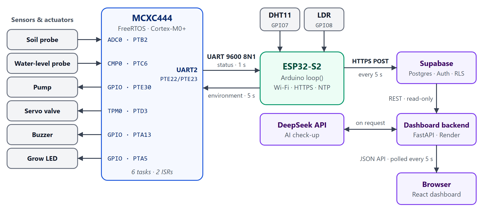
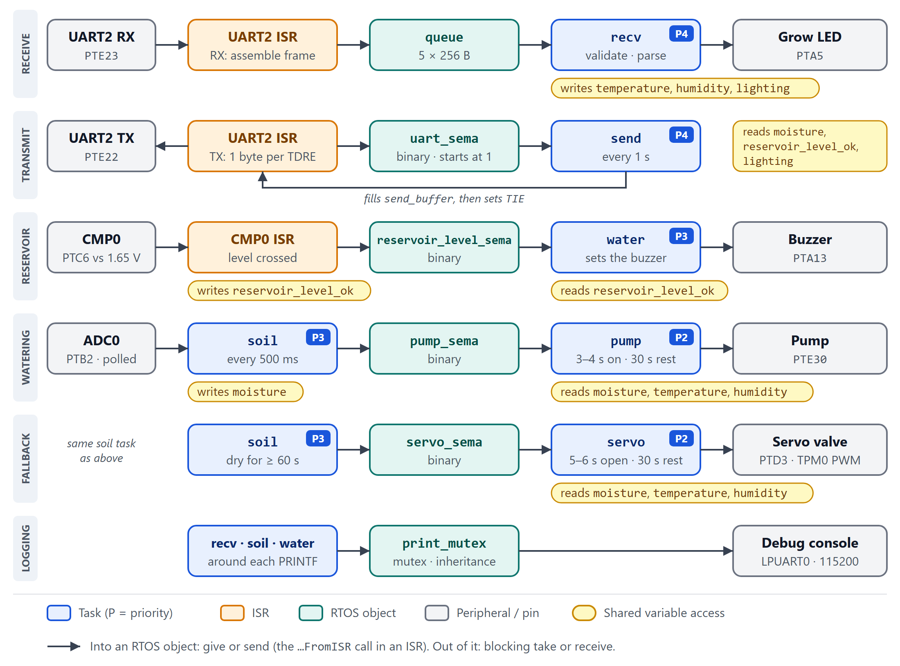
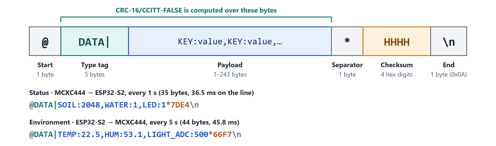

# CG2271 Real Time Operating Systems: Final Report

**2025/26 Semester 2 · Smart Greenhouse RTOS Project**

**Group B01_03**

| Name | Matric number |
|---|---|
| Chen Xingtong | A0300595H |
| Nandhimandalam Madhavakrishna Nandhana | A0287034A |
| Wang Jiawei | A0308058A |
| Louis Agara Perin | A0306755Y |
| Hua Zhenting | A0283162H |

## 1 Introduction

**User story:** A busy student or professional needs a system that detects dry soil, waters a potted plant automatically and allows the user to monitor remotely.

The project automatically irrigates a potted plant according to soil moisture while preventing watering when reservoir water is insufficient and enforcing watering limits. It provides remote environmental monitoring and AI-assisted watering-profile recommendations.

**Feature list**

- Automatic watering when the soil is dry, with a fixed run time and a 30 s cooldown.
- Longer watering when the air is hot or dry.
- A servo valve that takes over when the pump fails.
- A buzzer alarm while the reservoir is low.
- A grow LED that switches on when it is dark.
- A web dashboard with live readings, trends, a log and an AI check-up.

Two microcontrollers share the work (Figure 1). The **MCXC444** runs FreeRTOS and does everything that must react in real time: it samples the soil, watches the reservoir and drives the pump, servo valve, buzzer and LED. The **ESP32-S2** measures temperature, humidity and light, exchanges UART frames with the MCXC444 and uploads one reading to the cloud every 5 s.



**Figure 1.** System architecture. The boards exchange UART frames in both directions; only the ESP32-S2 talks to the cloud.

## 2 Sensors and actuators used

**Table 1.** Sensors and actuators, the data they give or use, and libraries

| Sensor / actuator | Data handling | Libraries used |
|---|---|---|
| DHT11 (ESP32-S2) | Air temperature (°C) and humidity (%), read every 3 s. Uploaded, and sent to the MCXC444, which waters 1 s longer at ≥ 30 °C or ≤ 45 % humidity. | DHTesp by beegee-tokyo: https://github.com/beegee-tokyo/DHTesp |
| LDR module (ESP32-S2) | 12-bit light reading every 1 s (median of 9 samples; lower is brighter). Uploaded as bright or dark, and sent to the MCXC444, which turns the grow LED on at ≥ 1000 (dark). | None (Arduino `analogRead()`) |
| Soil moisture probe (MCXC444) | 12-bit reading every 500 ms (higher is drier). Above 1200 requests watering. | None (bare-metal ADC0) |
| Water-level probe (MCXC444) | Compared with 1.65 V by the on-chip comparator; one bit, level OK or low. Drives the buzzer. | None (bare-metal CMP0) |
| Water pump | Runs 3 s (4 s when hot or dry) while the soil is dry, then a 30 s cooldown. | None (bare-metal GPIO) |
| Servo valve | Fallback: opens 5 s (6 s when hot or dry) once the soil has stayed dry for 60 s. | None (bare-metal TPM0 PWM) |
| Buzzer | On while the reservoir is low. | None (bare-metal GPIO) |
| Grow LED | On while it is dark. | None (bare-metal GPIO) |

The MCXC444 firmware also uses the FreeRTOS kernel and the NXP MCUXpresso SDK (start-up, clocks, debug console). The ESP32-S2 sketch also uses the Arduino-ESP32 core (Wi-Fi, HTTPS, UART) and Arduino_JSON.

## 3 Architecture of the project

### 3.1 Hardware architecture

#### Pin table

The boards are joined by three wires: the two UART lines, crossed, and a common ground. Both use 3.3 V logic.

<!-- TODO: insert the photo of the whole system here, e.g.  -->

**Table 2.** Pin connections

| Device | Pin | Peripheral |
|---|---|---|
| **MCXC444** | | |
| Soil moisture probe | PTB2 | ADC0 channel 12 |
| Water-level probe | PTC6 | CMP0 input 0 |
| Water pump (through its driver) | PTE30 | GPIO output, active high |
| Servo valve | PTD3 | TPM0 channel 3 (PWM) |
| Buzzer | PTA13 | GPIO output, active high |
| Grow LED | PTA5 | GPIO output, active high |
| UART link | PTE22 (TX) → GPIO16, PTE23 (RX) ← GPIO17 | UART2 |
| Debug console | PTA2 (TX), PTA1 (RX) | LPUART0, 115200 baud (`PRINTF`) |
| **ESP32-S2** | | |
| DHT11 | GPIO7 | Single-wire GPIO |
| LDR module | GPIO8 | 12-bit ADC |
| UART link | GPIO17 (TX), GPIO16 (RX) | UART1 (`Serial1`) |

#### Sensor / actuator programming

The MCXC444 devices are programmed bare-metal: each driver enables its clock gates in `SIM_SCGC`, selects the pin function in the port's `PCR[MUX]` field and then writes the peripheral's registers.

- **Soil probe: ADC0, polled (`adc.c`).** PTB2 stays analog (`MUX` = 0). `CFG1` selects 12-bit conversion, a long sample time and a 1.5 MHz clock (24 MHz bus clock ÷ 2 ÷ 8); `SC2` selects software triggering. `initADC0()` calibrates once with 32-sample averaging (`SC3[CAL]`) and computes the gain registers `PG` and `MG` from the calibration results. To read, `poll_soil_adc()` writes the channel to `SC1A`, which starts one conversion, waits for the `COCO` flag and returns `R[0]`. No interrupt is used: a conversion takes tens of microseconds, less than a context switch.
- **Water-level probe: CMP0, interrupt-driven (`cmp.c`).** The plus input is PTC6 (IN0); the minus input is the comparator's 6-bit DAC at (3.3 V / 64) × (31 + 1) = 1.65 V (`DACCR`, `MUXCR`). `CR0` selects the largest hysteresis (level 3), so a level hovering at the threshold does not chatter. `SCR[IER, IEF]` enables interrupts on both edges, at NVIC priority 2. The handler clears the edge flags `CFR` and `CFF`, which are write-1-to-clear, and copies the output bit `COUT` into `reservoir_level_ok`.
- **Pump, buzzer, LED: GPIO (`gpio.c`).** `initGPIO()` clears each output bit before setting the pin as a GPIO (`MUX` = 1) output in `PDDR`, so everything starts off. Pins are switched through `PSOR` and `PCOR`: writing 1 to a bit sets or clears that pin and writing 0 does nothing, so one store changes one pin without a read-modify-write of `PDOR`.
- **Servo valve: TPM0 PWM (`pwm.c`).** The timer runs from the 8 MHz MCGIRCLK divided by 128 (62.5 kHz, 16 µs per count) in centre-aligned mode (`CPWMS`) with `MOD` = 625, so the period is 2 × 625 counts = 20 ms (50 Hz). Channel 3 gives high-true pulses on PTD3 (`MUX` = 4) lasting 2 × `CnV` counts: `SERVO_MIN` = 31 gives 0.99 ms (closed) and `SERVO_MAX` = 62 gives 1.98 ms (open). `setServoPulse()` clamps its argument to that range. The hardware generates the pulses with no interrupt and no CPU time.
- **DHT11 (`sensor.cpp`).** DHTesp handles the single-wire timing: `dht.setup(7, DHTesp::DHT11)`, then `dht.getTempAndHumidity()` every 3 s. A reading is kept only if both values are finite and in range; otherwise the sensor is marked unavailable.
- **LDR (`sensor.cpp`).** The ADC is set to 12 bits with 11 dB attenuation. Each reading is the median of 9 `analogRead()` samples 2 ms apart, which removes spikes without the lag of averaging.

### 3.2 Software architecture

#### FSM

Each task is a simple loop, so the only state machines are the two watering tasks. Both cycle through **Waiting** (blocked on the semaphore) → **Watering** (actuator on for 3–6 s, entered only if the soil is still dry) → **Cooldown** (30 s) → Waiting. The states are positions in the task's code, timed by `vTaskDelay()`, so no state variable is needed. UART frame reception is a two-state machine in the ISR (idle or in a frame, Section 3.3).

#### Task structure

FreeRTOS runs with preemption and time slicing, a 200 Hz tick and five priority levels. `main()` creates all RTOS objects, initialises the drivers, creates six tasks (Table 3) and starts the scheduler; nothing is created or deleted afterwards.

**Table 3.** MCXC444 tasks. Each has a 190-word stack.

| Task | Priority | Activation | Responsibility |
|---|---|---|---|
| `recv` | 4 | Blocks on `queue` | Validates and parses each received frame, stores temperature, humidity and light, switches the grow LED. |
| `send` | 4 | Every 1 s | Formats the status payload and calls `UART2_Send()`. |
| `soil` | 3 | Every 500 ms | Samples ADC0 into `moisture`. On a dry sample (above 1200) gives `pump_sema`, and also `servo_sema` once the soil has been dry for 60 s. |
| `water` | 3 | Blocks on `reservoir_level_sema` | Sets the buzzer from `reservoir_level_ok`. |
| `pump` | 2 | Blocks on `pump_sema` | Re-checks `moisture`, runs the pump 3 s (4 s when hot or dry), waits 30 s. |
| `servo` | 2 | Blocks on `servo_sema` | Starts the PWM with the valve closed. Then re-checks `moisture`, opens the valve 5 s (6 s when hot or dry), closes it, waits 30 s. |

The communication tasks have the highest priority so the UART link is serviced promptly; the sensor tasks come next; the watering tasks are lowest because their tolerance is in seconds. Every task blocks between short bursts of work, so none is starved.

**Interrupts** (both at NVIC priority 2). `UART2_FLEXIO_IRQHandler` handles a received byte (`RDRF`), an overrun (`OR`) and transmit-register-empty (`TDRE`, enabled only while a frame is being sent). `CMP0_IRQHandler` handles a change of the comparator output. Both do a small fixed amount of work, never block, call only `…FromISR` functions and end with `portYIELD_FROM_ISR()`.

**ESP32-S2.** One Arduino `loop()` and no tasks of its own. Jobs run when their interval has elapsed on `millis()`: read the LDR (1 s), read the DHT11 (3 s), send an environment frame (5 s) and upload a reading (5 s). UART input is drained at the start of every pass, before any job that may wait on the network.

#### Coordination & synchronisation

Interrupt handlers only capture an event and hand the rest to a task (deferred interrupt processing). No task polls for an event: each waits on one RTOS object or on `vTaskDelay()` (Figure 2, Table 4).



**Figure 2.** MCXC444 tasks, interrupts and synchronisation objects, one row per data path. The yellow labels show who writes or reads each shared variable.

**Table 4.** Synchronisation objects

| Object | Type | Given / sent by | Taken by | Purpose |
|---|---|---|---|---|
| `queue` | Queue, 5 × 256-byte `TMessage` | UART2 ISR, when `\n` completes a frame | `recv` | Copies each frame out of the ISR so decoding runs in a task. If the queue is full the ISR drops the frame rather than block. |
| `uart_sema` | Binary semaphore, given once at start-up | UART2 ISR, after the last byte | `send` | "Transmitter free" token: one frame in flight at a time. |
| `reservoir_level_sema` | Binary semaphore | CMP0 ISR, on each edge | `water` | Wakes the water task to update the buzzer. |
| `pump_sema` | Binary semaphore | `soil`, on each dry sample | `pump` | Requests watering. |
| `servo_sema` | Binary semaphore | `soil`, on each dry sample after 60 s dry | `servo` | Requests fallback watering. |
| `print_mutex` | Mutex | `recv`, `soil`, `water` | The same tasks | Serialises console output. |

**Watering.** The soil task gives `pump_sema` on every dry sample, twice a second. The pump task takes it, re-checks `moisture`, runs the pump and then sleeps through the cooldown so the water can soak in. A binary semaphore holds at most one give, so the requests made meanwhile collapse into one pending request; after the cooldown the task takes it, re-checks the soil and waters again only if it is still dry.

**Servo fallback.** The firmware cannot sense the pump, so it infers a failure from the result. The soil task keeps the tick count of the last wet sample (`last_wet`); if the soil is still dry 60 s later, the pump has had about two attempts without effect, and the task gives `servo_sema` as well. The servo task then works like the pump task. The pump keeps trying in parallel, and the first wet sample resets `last_wet` and returns the system to pump-only watering.

**Sending a frame.** `UART2_Send()` never waits for the hardware: it takes `uart_sema`, builds the frame in `send_buffer`, enables the `TDRE` interrupt and returns. The ISR writes one byte per interrupt; after the last byte it disables the interrupt and gives the semaphore back. A 35-byte status frame takes 36.5 ms, during which the CPU runs other tasks.

**Between the boards.** Neither board waits for the other. Each sends on its own timer and the receiver keeps the latest valid values.

#### Resource protection

**Table 5.** Shared resources and their protection

| Resource | Used by | Protection |
|---|---|---|
| UART2 transmitter and `send_buffer` | `send`, UART2 ISR | `uart_sema`: the task writes the buffer only after taking it and the ISR gives it back only after the last byte, so a frame being sent cannot be overwritten. |
| Frame being received | UART2 ISR | Owned by the ISR; the queue hands `recv` its own copy. |
| Debug console | `recv`, `soil`, `water` | `print_mutex` around each `PRINTF`, so lines do not interleave. |
| LED, buzzer and pump pins | `recv`, `water`, `pump` | One owning task per pin. `PSOR` and `PCOR` change only the written bit in a single store, so the LED and buzzer tasks, both on port A, cannot undo each other's writes. |
| TPM0, ADC0 | `servo`, `soil` | Single owner each. |
| Shared variables | Tasks, CMP0 ISR | One writer each (below). |

**Shared variables.** `moisture` is written only by `soil`, `reservoir_level_ok` only by the CMP0 ISR, and `lighting`, `temperature` and `humidity` only by `recv`. Each is at most 32 bits and aligned, so on the Cortex-M0+ every access is one indivisible load or store: a reader always sees a complete value and no lock is needed. `reservoir_level_ok` is `volatile` because an interrupt changes it.

**Why `uart_sema` is not a mutex.** It is taken by a task but given by the ISR. A FreeRTOS mutex must be released by the task that took it and cannot be given from an interrupt (`configASSERT` would halt the firmware), so a binary semaphore given once at start-up serves as the token. `print_mutex` is taken and released by the same task, so it is a real mutex, and its priority inheritance limits how long `recv` can wait behind a lower-priority print.

**Start-up order.** `main()` creates every RTOS object before `initCMP0()` and `initUART2()` enable their interrupts, so a handler never uses an object that does not exist yet.

### 3.3 Communication protocol between ESP32 and MCXC444

**Table 6.** UART settings

| Setting | MCXC444 | ESP32-S2 |
|---|---|---|
| Peripheral and pins | UART2: TX PTE22, RX PTE23 (`MUX` = 4) | UART1 (`Serial1`): TX GPIO17, RX GPIO16 |
| Format | 9600 baud, 8N1, no flow control | The same |
| Baud divisor | SBR = 24 MHz / (16 × 9600) ≈ 156, giving 9615 baud (+0.16 %) | Set by the driver |
| Receiving | Interrupt per byte (`RDRF`) and on overrun; frames assembled in the ISR | Driver buffer, drained by `loop()` |
| Transmitting | `TDRE` interrupt, enabled only during a frame | `Serial1.write()` |

Both directions use the same ASCII frame (Figure 3): `@`, the tag `DATA|`, a payload of comma-separated `KEY:value` pairs, `*`, a CRC-16 as four hexadecimal digits and a line feed. The checksum is CRC-16/CCITT-FALSE (polynomial 0x1021, initial value 0xFFFF) over the tag and payload. A frame is at most 255 bytes, so it fits a 256-byte buffer.



**Figure 3.** Frame format, with an example in each direction.

**Table 7.** Messages

| Message | Sent | Payload |
|---|---|---|
| Status (MCXC444 → ESP32-S2) | Every 1 s | `SOIL:%u,WATER:%d,LED:%d` |
| Environment (ESP32-S2 → MCXC444) | Every 5 s, only while both sensor readings are at most 10 s old | `TEMP:%.1f,HUM:%.1f,LIGHT_ADC:%d` |

**Receiving** has three stages on both boards:

1. **Assembly**, byte by byte (in the UART2 ISR on the MCXC444). Bytes are ignored until `@`; any `@` restarts the frame, so the receiver re-synchronises after noise; bytes are stored until `\n`. An over-long frame or a receiver overrun discards the partial frame.
2. **Validation** of the complete frame in task context: framing, separator position and CRC.
3. **Parsing.** Values are accepted only if every field parses; the ESP32-S2 also checks ranges.

A frame that fails any check is dropped. There is no acknowledgement or retransmission: the messages carry periodic state, so the next frame replaces a lost one.

**Additional features.** Neither direction busy-waits on the MCXC444. The ESP32-S2 sends climate data only while it is fresh, so the MCXC444 never acts on stale values, and treats the MCXC444's status as missing after 15 s without a valid frame.

### 3.4 Application to an online function

The ESP32-S2 is the only link to the internet. Every 5 s it combines its own sensor readings with the latest MCXC444 status into one JSON record and inserts it into a cloud database over HTTPS; the dashboard and the AI check-up read from there (Section 4). Data flows one way, board → database → dashboard, so watering keeps working when Wi-Fi or any online service is down.

## 4 Online function used

### 4.1 Description of function used

**Table 8.** Online services

| Service | Role | How it is used |
|---|---|---|
| **Supabase** (hosted PostgreSQL with a REST API) | Stores every reading | The ESP32-S2 signs in as a device account and inserts one row every 5 s. Row-level security lets the device only insert its own rows and the dashboard's account only read. |
| **Dashboard on Render** (FastAPI and React) | Remote monitoring | The backend reads the rows and the browser polls it every 5 s: live readings, trends over 1 h or 24 h (thinned to about 1,000 points) and a log of the latest 20 readings. |
| **DeepSeek API** (large language model) | AI check-up | On request, the backend sends the readings as CSV with a description of the watering rule. The reply (status, headline, summary, advice) is validated before it is shown; one request per 15 s. |

The ESP32-S2 also uses public NTP servers to set its clock, which it needs to verify HTTPS certificates.

### 4.2 Data sent and received by ESP32

All requests are JSON over HTTPS, with the server certificate verified against root certificates stored in the sketch.

**Table 9.** ESP32-S2 requests to Supabase

| Request | When | Data sent | Data received |
|---|---|---|---|
| Sign-in: `POST /auth/v1/token` | At the first upload, and 60 s before the token expires or after a 401 | Device `email` and `password`; API key in a header | `access_token` and `expires_in`; the token is cached in memory |
| Insert: `POST /rest/v1/readings` | Every 5 s | One reading (below); API key and token in headers | HTTP 201, empty body. A failed insert is logged, not retried; the next upload sends a fresh sample |

```json
{"device_id":"<device id>","temperature":29.4,"humidity":61.0,"light_state":true,
 "soil_adc_raw":2048,"reservoir_state":true,"led_state":false,"faults":[],"test_data":false}
```

`temperature`, `humidity` and `light_state` come from the ESP32-S2's sensors; `soil_adc_raw`, `reservoir_state` and `led_state` from the MCXC444's status frame. A sensor reading older than 10 s, or MCXC444 status older than 15 s, is sent as `null`, and `faults` names the cause: `DHT11_UNAVAILABLE`, `LIGHT_SENSOR_UNAVAILABLE` or `MCXC444_UNAVAILABLE`. The ESP32-S2 receives no commands from the cloud; besides the two replies, the only online data it takes in is the NTP time.

## 5 Special features

- **Redundant watering.** A failed pump is inferred from soil that stays dry for 60 s, and a servo valve then waters as well.
- **Control across both boards.** Watering time depends on the ESP32-S2's temperature and humidity, and the grow LED on its light reading.
- **Hardware reservoir alarm.** The comparator, with hysteresis, interrupts only when the level crosses the threshold, so the buzzer reacts at once without polling.
- **Fully event-driven firmware.** No task polls for an event and no UART byte is busy-waited for.
- **Robust data path.** CRC-16 frames that re-synchronise on their own, and fault codes instead of stale values in the cloud.
- **Secure cloud access.** Verified HTTPS, separate device and dashboard accounts, and row-level security.
- **AI check-up.** An on-demand summary of the plant's condition with advice, on a dashboard reachable from anywhere.

## 6 Challenges faced & solutions

| Challenge | Solution |
|---|---|
| The pump was unreliable and sometimes failed to deliver water. | A servo valve was added as a second way to water. Since the firmware cannot sense the pump, it treats soil that stays dry for 60 s as a pump failure and opens the valve as well. |
| The UART transmitter must stay reserved until the ISR has sent the last byte, but a mutex cannot be released from an interrupt. | A binary semaphore, given once at start-up, is used as a "transmitter free" token: taken by the send task and given back by the ISR. |
| The right soil threshold depended on the probe, the soil and the pot, and had to be changed on demo day (1600 to 1200). | The threshold is a single constant in the firmware, mirrored by one constant in the dashboard backend, so retuning is a one-line change on each side. |
| HTTPS requests on the ESP32-S2 can block for seconds, during which status frames from the MCXC444 pile up. | UART input is drained at the start of every loop pass and again just before a reading is built, and the frame format lets the receiver re-synchronise after any lost bytes. |
| A 24 h window holds about 17,000 readings, too many to plot. | The backend thins the window evenly to about 1,000 points, while the log page shows the latest readings unthinned. |
